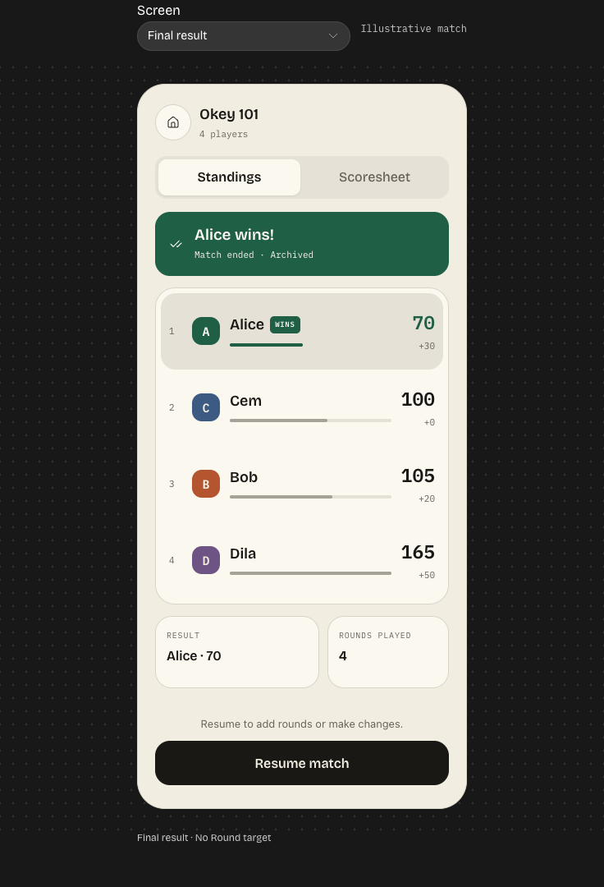
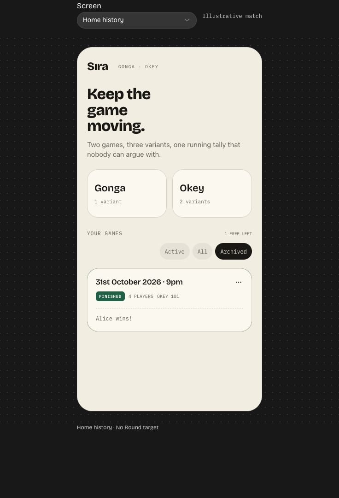

# 01 — Preserve existing Match results through migration

**What to build:** Existing tables can update to schema V2 and reopen their saved Matches without losing scores, results, history visibility or Free Match accounting. This is the preparatory compatibility slice: the current experience remains usable while the target-free flow is introduced by ticket 02.

**Blocked by:** None — can start immediately.

**Status:** complete

- [x] Introduce schema V2 while preserving the actual V1 stored shape and relationships for migration.
- [x] Capture an Okey 101 Match's old completion before its Round target loses its meaning. A Match that reached its target has a persisted ending state; an unfinished Match does not.
- [x] Keep ending state independent of Archived and Started. Preserve each migrated Match's existing archive visibility, including completed but unarchived Matches; migration must not retroactively archive them.
- [x] Preserve Match identity, creation date, Entrants and Seats, ordered Rounds, raw deltas, modifiers and stored events. Gonga and Okey retain their parameters and outcomes.
- [x] Reconcile the existing legacy Started/tally obligations without refunding or double-spending a Free Match. A previously Started Match with zero current Rounds survives as Started and unfinished.
- [x] The current app still opens saved Matches and displays the same results and visibility after migration. While the old count-driven experience remains active, scoring or Undo must not leave the prepared ending state stale for ticket 02's cutover.
- [x] A second launch does not repeat migration or alter preserved state. Migration failure must not be mistaken for successful preservation merely because recovery opens an empty store.
- [x] Prove compatibility through the existing MatchStore boundary using a real V1 on-disk fixture, migration, and a second launch. Cover custom targets, completed/unfinished Matches in both archive states, tied results, zero-current-Round Started Matches, scoring facts and access accounting. Assert user-visible scores/results and retained history, not private migration helper structure.

## Scope and handoff

Do not remove Setup controls or introduce End/Resume UI here. Keep this preparation compatible with the current app; ticket 02 retires count-driven completion and any temporary compatibility behavior. No new product mode, user setting or permanent legacy-rule fork is needed.

[Feature spec](../spec.md) · [ADR 0012](../../../docs/adr/0012-okey101-ends-by-table-decision.md)

Spec stories: 36, 37, 39, 40, 41, 44.

## Relevant approved mockups

[Interactive flow](../mockups/flow.html) · [Mockup guide](../mockups/README.md)

The final-result and Home screens establish the destination for preserved results. This ticket preserves existing rendering; their new actions and composition belong to later tickets.

## Comments

### Implementation handoff — 2026-11-14

- Completed in commit `16453af7d454a74d39f763072853c06a6b2f3de4` on `feature/okey101-manual-ending-plan`; parent verified the commit and acceptance coverage before advancing.
- Froze all five V1 entities and added schema V2 with persisted Okey 101 ending state. Real V1 stores retain completion, archive visibility, Seats/order, raw scores/modifiers/events, Started and tally history through two launches. Ordinary count-era scoring/Undo keeps the prepared result current.
- Checks: five real-disk migration tests pass; final focused run 242/242 passed. Full run 420 passed and 113 image-reference mismatches; approved baseline 6102d69 has the exact same 113 failing test names (415 passed). Zero introduced failures; representative Home, Setup and Play renders are byte-identical. Existing unrelated references were preserved.
- Standards and Spec reviews: zero findings; diff whitespace check passed. Evidence and exact commands: `/private/tmp/sira-ticket01-20261114/` (`test-evidence.json`, `validation-commands.txt`, `review.txt`).
- Simulator: dedicated iPhone 18 Pro Max / iOS 27.0 (24A434), UDID `5F954F4C-38B9-40E4-BD15-CC240D806DCD`. Task sessions stopped and device shut down/deleted; all 15 original device states unchanged and Simulator app remained closed. Parent read back `cleanup-verification.json`.
- Ticket 02: retire ordinary-play `prepareCountBasedEnding()` calls at manual-ending cutover, while keeping V1 migration inference. Its frozen `okey-101` identity check must remain independent of the renamed live Win Condition. New/changed UI references must be intentionally verified on the permitted simulator; the 113 inherited iOS 27 rendering mismatches are not new regressions.
