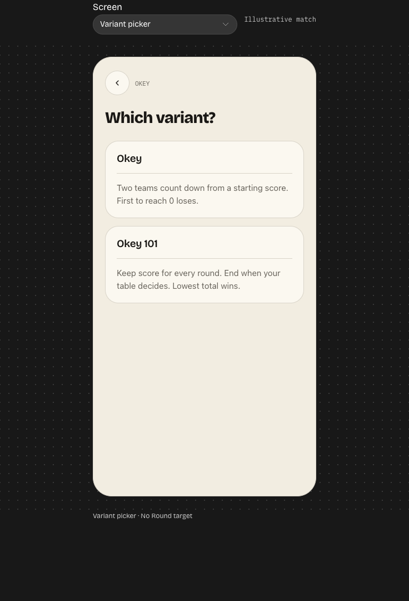
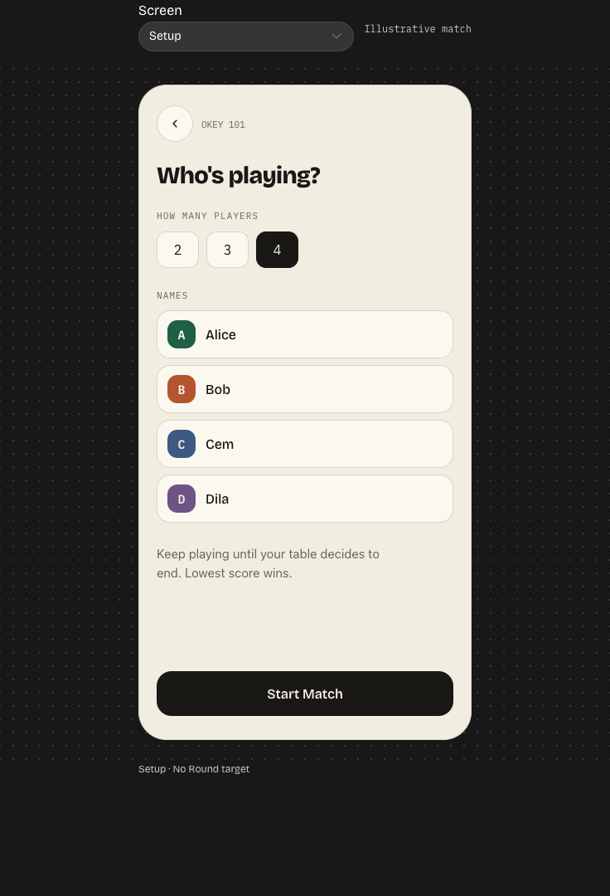
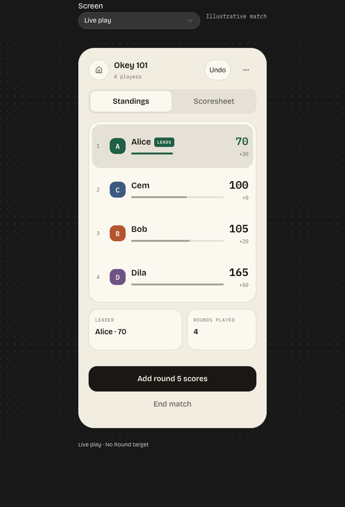

# 02 — Start and score target-free Okey 101 Matches

**What to build:** A table chooses Okey 101, supplies its players and names, starts without choosing a Round count, and continues scoring for as long as it wants. Home and Play describe actual play rather than a target.

**Blocked by:** [01 — Preserve existing Match results through migration](01-preserve-results-through-migration.md).

**Status:** ready-for-agent

- [ ] The Okey picker retains both Variants and explains that Okey 101 ends when the table decides and the lowest total wins.
- [ ] Okey 101 Setup retains player count and names but has no Round presets, custom-count field, count validation, implicit target or conventional-count milestone. Show: “Keep playing until your table decides to end. Lowest score wins.”
- [ ] A new Okey 101 Match without a VariantParameter is valid, can be created, routed into Play, listed on Home after it Starts, saved and reopened. Missing required parameters for Gonga/Okey and unresolved Variant identities retain their existing handling.
- [ ] Lowest Total replaces Fixed Rounds for Okey 101. Running totals, Çifte, Okey atmak, per-Round input bounds, Seats, roster restrictions and Round ordering remain correct.
- [ ] Okey 101 no longer becomes complete when a Round count is reached. Existing unfinished Matches lose their old targets' meaning; existing completed Matches retain ticket 01's persisted ending state. Remove temporary count-completion compatibility writes introduced during that preparation.
- [ ] Score beyond both conventional counts and the former 50-Round maximum without a stop, extension prompt or final-winner declaration. Live standings remain provisional.
- [ ] Play shows Rounds played instead of Rounds left. Home and Play omit Okey 101 target metadata, including for migrated Matches.
- [ ] Starting on the first scored Round and subsequent Free Match accounting remain unchanged. Undo back to zero retains Started; leaving a newly set-up Match and reopening history follow existing rules.
- [ ] Use existing MatchStore/engine and presentation test patterns for target-free creation, routing, persistence, indefinite scoring, migrated live/completed states and scoring modifiers. Retain Gonga/Okey parameter and automatic-ending regression coverage.
- [ ] Update the affected picker, Setup, Home metadata and live Play snapshots in Paper/Felt. Verify a fresh zero-Round Match remains playable, even though it has no target.

## Scope and handoff

End confirmation and explicit final-result review arrive in ticket 03; Resume arrives in ticket 04. The approved live and zero-Round mockups show the completed flow, including End controls that are outside this ticket. Preserve the incumbent identity and native control behavior rather than adding a new design system.

[Feature spec](../spec.md) · [ADR 0012](../../../docs/adr/0012-okey101-ends-by-table-decision.md)

Spec stories: 1, 2, 3, 4, 5, 6, 7, 8, 38, 43, 44.

## Relevant approved mockups

[Interactive flow](../mockups/flow.html) · [Mockup guide](../mockups/README.md)

