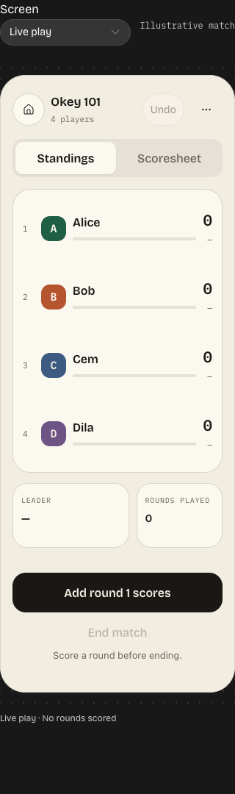

# 02 — Start and score target-free Okey 101 Matches

**What to build:** A table chooses Okey 101, supplies its players and names, starts without choosing a Round count, and continues scoring for as long as it wants. Home and Play describe actual play rather than a target.

**Blocked by:** [01 — Preserve existing Match results through migration](01-preserve-results-through-migration.md).

**Status:** complete

- [x] The Okey picker retains both Variants and explains that Okey 101 ends when the table decides and the lowest total wins.
- [x] Okey 101 Setup retains player count and names but has no Round presets, custom-count field, count validation, implicit target or conventional-count milestone. Show: “Keep playing until your table decides to end. Lowest score wins.”
- [x] A new Okey 101 Match without a VariantParameter is valid, can be created, routed into Play, listed on Home after it Starts, saved and reopened. Missing required parameters for Gonga/Okey and unresolved Variant identities retain their existing handling.
- [x] Lowest Total replaces Fixed Rounds for Okey 101. Running totals, Çifte, Okey atmak, per-Round input bounds, Seats, roster restrictions and Round ordering remain correct.
- [x] Okey 101 no longer becomes complete when a Round count is reached. Existing unfinished Matches lose their old targets' meaning; existing completed Matches retain ticket 01's persisted ending state. Remove temporary count-completion compatibility writes introduced during that preparation.
- [x] Score beyond both conventional counts and the former 50-Round maximum without a stop, extension prompt or final-winner declaration. Live standings remain provisional.
- [x] Play shows Rounds played instead of Rounds left. Home and Play omit Okey 101 target metadata, including for migrated Matches.
- [x] Starting on the first scored Round and subsequent Free Match accounting remain unchanged. Undo back to zero retains Started; leaving a newly set-up Match and reopening history follow existing rules.
- [x] Use existing MatchStore/engine and presentation test patterns for target-free creation, routing, persistence, indefinite scoring, migrated live/completed states and scoring modifiers. Retain Gonga/Okey parameter and automatic-ending regression coverage.
- [x] Update the affected picker, Setup, Home metadata and live Play snapshots in Paper/Felt. Verify a fresh zero-Round Match remains playable, even though it has no target.

## Scope and handoff

End confirmation and explicit final-result review arrive in ticket 03; Resume arrives in ticket 04. The approved live and zero-Round mockups show the completed flow, including End controls that are outside this ticket. Preserve the incumbent identity and native control behavior rather than adding a new design system.

[Feature spec](../spec.md) · [ADR 0012](../../../docs/adr/0012-okey101-ends-by-table-decision.md)

Spec stories: 1, 2, 3, 4, 5, 6, 7, 8, 38, 43, 44.

## Relevant approved mockups

[Interactive flow](../mockups/flow.html) · [Mockup guide](../mockups/README.md)

## Comments

### Implementation handoff — 2026-11-14

- Completed in `1bde6fb1c858df43472e039a92d27107b6a43012` (target-free flow) and `ac6aaa26cafcb25fb8bd8c80b7c3d0bbf9d8b587` (snapshot host isolation) on `feature/okey101-manual-ending-plan`. Parent verified the commits, engine/routing/Setup changes, evidence and representative native renders.
- Okey 101 now needs no VariantParameter; Lowest Total uses persisted `ended`, leaving migration inference frozen and removing count-era writes during ordinary play. Added 104-Round, Undo/re-score accounting and two-launch coverage. Picker/Setup explanations, Rounds played, Home/Play/entry metadata and zero-Round no-leader behavior are implemented.
- Checks: focused regressions 265/265; final full suite 535 tests, 433 passed, 102 inherited image-reference mismatches. All 13 new/affected feature snapshots pass in normal full-suite order; zero new failing test names versus ticket 01. Standards/Spec reviews and whitespace check are clear.
- New essential Setup text uses 0.7 ink opacity; Play title uses explicit theme ink in Felt. Parent inspected the native Setup and live Play references.
- Snapshot handoff: production NavigationStack is unchanged. Snapshot Play/Setup content directly; picker uses a stack-style NavigationView test host. This avoids reproduced iOS 27 nested-host toolbar inset leakage while retaining fixed dimensions and exact image assertions. Keep these stable hosts in later snapshot additions.
- Evidence and commands: `/private/tmp/sira-ticket02-20261114/` (`test-evidence.json`, `validation-commands.txt`, `review.txt`). Build cache remains at `/private/tmp/sira-ticket01-20261114/DerivedData` if useful.
- Cleanup: dedicated iPhone 18 Pro Max / iOS 27.0 (24A434), UDID `1D985186-C600-4D52-A69A-7D80DF872996`, deleted; no task build sessions remain; all 15 original device states unchanged; Simulator app stayed closed. Parent read back cleanup evidence.
- Ticket 03 owns explicit End and read-only result review; ticket 04 owns Resume. No future controls were implemented prematurely. Live `ended` is still directly settable for fixtures; new user mutations belong at the shared MatchStore/domain boundary.
