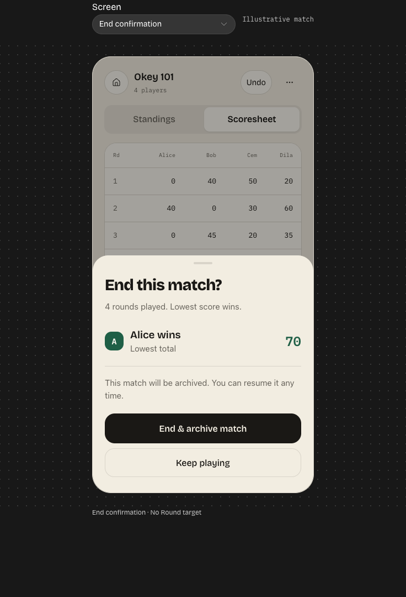
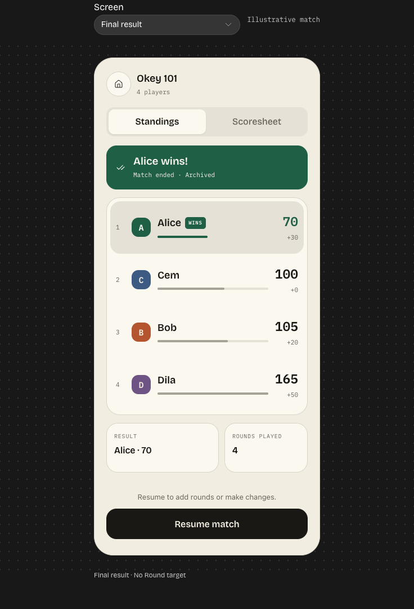
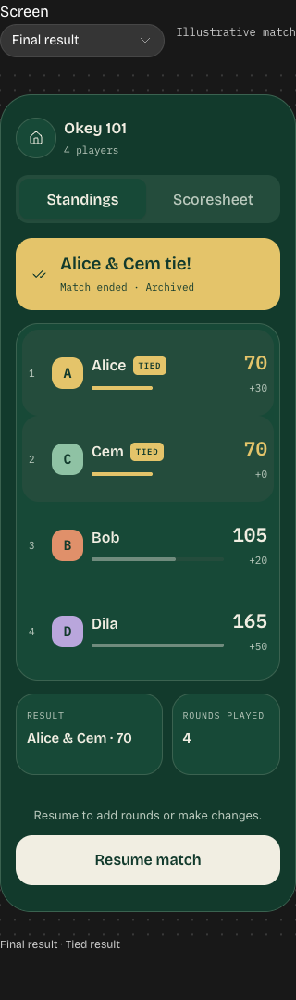
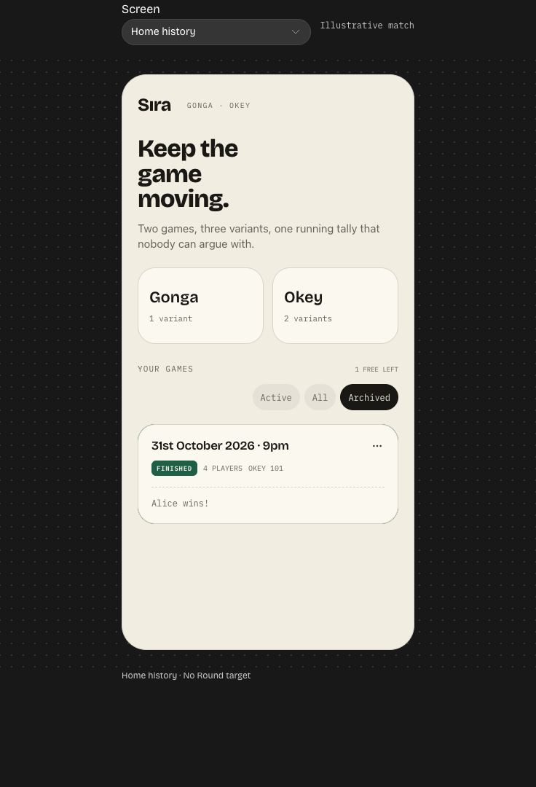

# 03 — End, archive and review an Okey 101 Match

**What to build:** A table explicitly ends an Okey 101 Match from either Play tab, checks the prospective result, and confirms or cancels. A confirmed ending archives the Match and shows its read-only final standings; opening it from Home reviews the result without restarting play.

**Blocked by:** [02 — Start and score target-free Okey 101 Matches](02-start-and-score-target-free-matches.md).

**Status:** ready-for-agent

- [ ] Add round remains primary. End match is a secondary action available from both Standings and Scoresheet, including for a live Archived Match.
- [ ] End is unavailable with zero currently scored Rounds, both immediately after Setup and after Undo removes every Round. Explain that a Round must be scored first; leaving Play remains possible. Enforce eligibility through the shared domain/store boundary as well as the UI.
- [ ] End opens a focused confirmation showing the current Round count and prospective winner or all tied lowest-total Entrants. Explain that confirmation archives the Match and it can later Resume.
- [ ] Cancel leaves scores, ending state, archive state and the selected Play tab unchanged.
- [ ] Confirm uses a shared MatchStore End operation that persists ending and archiving together. It dismisses the confirmation, selects Standings even if invoked from Scoresheet, and shows the final result without automatically returning Home.
- [ ] Final standings remain in the existing Play screen, with a way Home and a readable Scoresheet. Banner, result tile, confirmation and Home summary consistently identify every tied winner.
- [ ] Ended Matches refuse score entry, Undo and renaming at the ordinary mutation boundary and in the UI. The read-only Scoresheet must not advertise Undo. This protection applies to migrated completed Matches as well as newly Ended ones.
- [ ] Newly Ended Matches leave Active and are discoverable in All and Archived. Tapping the main content of the Home card opens the read-only result without changing ending or archive state. Keep Home's filter meanings and start-date ordering.
- [ ] Avoid exposing an Ended Match's old Restore action as a substitute for Resume. Ticket 04 supplies the deliberate Resume affordances and complete state-aware Home actions; keep live Archive/Restore and Gonga/Okey behavior working during this slice.
- [ ] A relaunch retains the final result, scores, read-only behavior and archive state. Ending or reviewing consumes no additional Free Match and does not change Started.
- [ ] Exercise End eligibility, cancellation, confirmation from both tabs, unique/tied results, guarded mutations and persisted outcomes using the approved store seam and existing presentation/navigation patterns. Use real on-disk reopen coverage for durability.
- [ ] Snapshot the confirmation and Ended views in Paper/Felt, including a tie and read-only Scoresheet. Verify focused sheet behavior, readable copy, 44-point effective touch targets, Reduce Motion and native navigation without adding a UI-testing framework.

## Scope and handoff

The final-result mockups include the Resume button implemented by ticket 04; do not require that ticket's action in this slice. Keep its place in the final design clear while preserving a coherent read-only review screen. This ticket does not change Round scoring, other Variants' endings or roster capabilities.

[Feature spec](../spec.md) · [ADR 0012](../../../docs/adr/0012-okey101-ends-by-table-decision.md)

Spec stories: 9, 10, 11, 12, 13, 14, 15, 16, 17, 18, 19, 20, 21, 22, 36, 44.

## Relevant approved mockups

[Interactive flow](../mockups/flow.html) · [Mockup guide](../mockups/README.md)

Also use the [zero-Round eligibility reference](../mockups/zero-rounds-paper.png) when verifying that End is unavailable before scoring or after Undo removes every Round.

