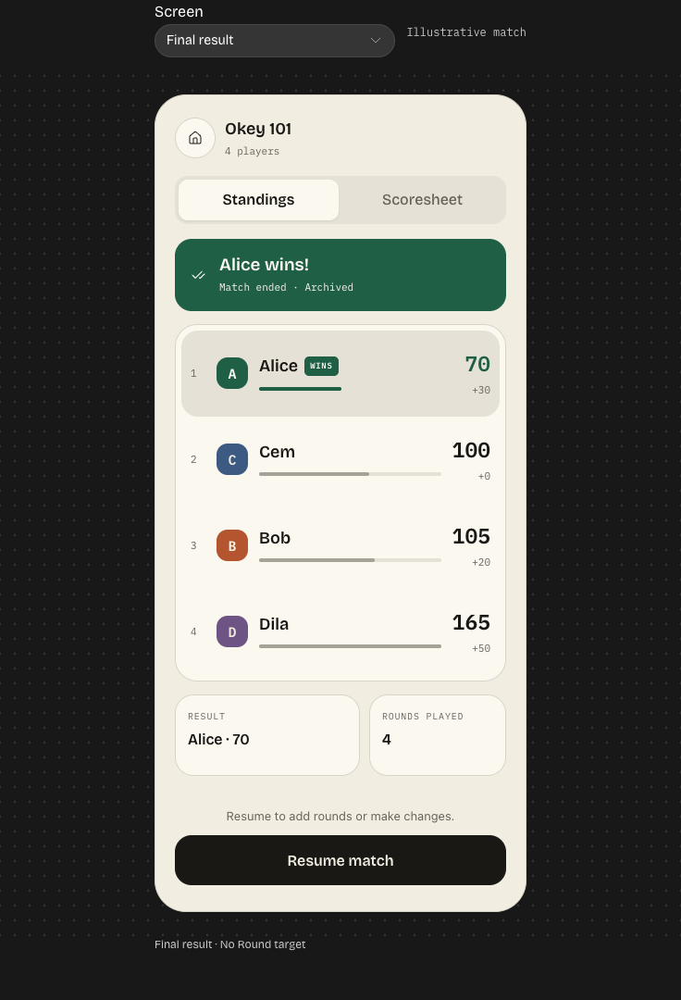
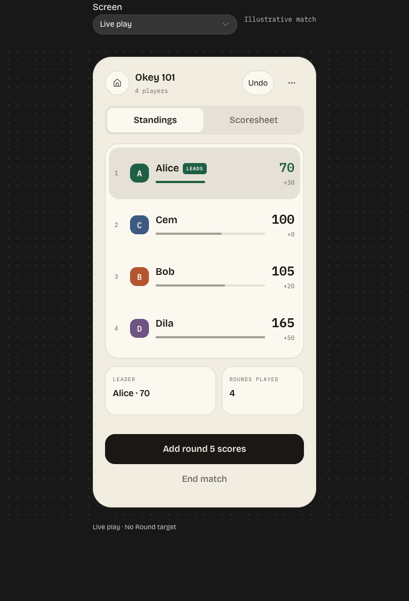

# 04 — Resume from Play or Home

**What to build:** A table deliberately resumes an Ended Okey 101 Match from Play or Home, keeping its history and returning it to Active. It can correct or add scores and end again without spending another Free Match. Archiving a live Match remains a separate visibility-only action.

**Blocked by:** [03 — End, archive and review an Okey 101 Match](03-end-archive-and-review-a-match.md).

**Status:** ready-for-agent

- [ ] Ended Play replaces the disabled bottom scoring button with Resume match, available while reviewing Standings or Scoresheet. No additional confirmation is required.
- [ ] Play and Home use the same MatchStore Resume operation to reopen and unarchive together. Preserve Match identity, creation date, Entrants, Seats, Rounds, raw scores, modifiers and totals.
- [ ] Resume returns to live Play, re-enables permitted scoring, Undo and renaming, and replaces the final outcome with provisional standings. Scoring more Rounds or correcting an existing total supports another explicit End with a newly derived result.
- [ ] Home offers Resume instead of Restore for an Ended Okey 101 Match, including a migrated Ended Match that was never Archived. Its action resumes and opens Play; merely opening the card continues to show the read-only result.
- [ ] Home's full card content remains a review target separate from its action control. Keep the date, status and result readable before the swipe/action is revealed, following the approved mockup's reviewed state.
- [ ] A resumed Match returns to Active without changing its original start-date position. All/Archived semantics remain unchanged, and repeated End/Resume cycles retain correct visibility.
- [ ] A live Match can still be manually Archived without ending it. Restore on a live Archived Match changes visibility only, and the Match remains scorable while Archived. Use state-aware actions without changing Gonga/Okey controls.
- [ ] Resume, subsequent scoring and re-ending require no Unlock even with exhausted Free Matches. They neither create nor Start another Match, refund a Free Match nor spend another one.
- [ ] Undoing all Rounds after Resume leaves Started permanent and the Match live; End is unavailable until another Round is scored. That next Round does not spend a Free Match again.
- [ ] Persist resumed state and further scores across relaunch. Migration completion inference must not re-end a resumed legacy Match on later launches, including after Undo or additional Rounds.
- [ ] Cover both Resume entry points, legacy Ended/unarchived Matches, repeated cycles, correction, archive distinctions, retained ordering and exhausted-access accounting through the existing store and presentation/navigation seams. Reopen the on-disk store to prove resumed state and history survive.
- [ ] Update Paper/Felt snapshots for final review, live Play and Home's state-aware actions. Walk through End → review → Resume → score/correct → End from both entry points; no new UI-automation framework is required.

## Scope and handoff

Reuse ticket 03's End and read-only behavior; do not duplicate lifecycle logic between screens or introduce a new Match, reset workflow, activity-date sorting or new roster capability. Long-history presentation improvements remain in ticket 05, which is independently unblocked by ticket 02.

[Feature spec](../spec.md) · [ADR 0012](../../../docs/adr/0012-okey101-ends-by-table-decision.md)

Spec stories: 23, 24, 25, 26, 27, 28, 29, 30, 31, 32, 33, 34, 35, 36, 44.

## Relevant approved mockups

[Interactive flow](../mockups/flow.html) · [Mockup guide](../mockups/README.md)

In Home history, reveal the existing swipe action or action control in the interactive preview to see Resume; the static reference intentionally starts with the full card visible.

The [tied result in Felt](../mockups/tied-result-felt.png) also shows the Resume placement for a shared result.

