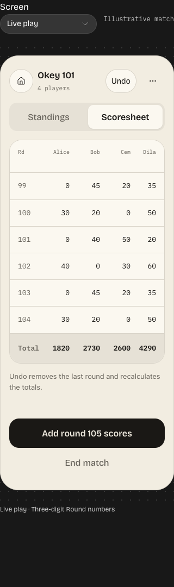

# 05 — Keep long Scoresheets readable and responsive

**What to build:** Tables can inspect and continue an Okey 101 history beyond 100 Rounds without losing column context, breaking Round labels or waiting on repeated history calculations. Open-ended play stays practical without adding a new count limit.

**Blocked by:** [02 — Start and score target-free Okey 101 Matches](02-start-and-score-target-free-matches.md).

**Status:** ready-for-agent

- [ ] Exercise a history beyond the old 50-Round maximum and a representative history of at least 104 Rounds. Scoresheet deltas and totals match the engine, all saved Rounds remain accessible, and ordering follows Round sequence.
- [ ] Three-digit Round numbers fit without clipping, overlap or stealing readable player-score columns at compact phone widths. “Total” remains on one line and four-digit sample totals remain legible.
- [ ] Keep player-column names visible while scrolling long history, following the approved reviewed mockup. Preserve correct alignment between names, per-Round scores and totals.
- [ ] Scoring another Round and Undo update history and totals correctly, including zero-Round recovery, existing modifiers and stored events. Do not widen raw score-entry bounds, introduce late Okey 101 Joins or add a replacement Match cap.
- [ ] Check responsiveness with the representative long history. Avoid repeatedly replaying every prefix or eagerly constructing the entire offscreen history when it causes a material problem; make any calculation/rendering changes preserve the external Scoresheet contract and other Variants' behavior.
- [ ] Verify long history and totals survive saving and reopening through the existing MatchStore seam. Reuse existing Scoresheet/engine tests for observable rows and totals; do not test the chosen cache or rendering algorithm's internals.
- [ ] Add the focused compact-layout snapshot coverage and inspect Paper/Felt, longer names and larger text. Use a focused responsiveness walkthrough rather than fragile wall-clock assertions or a new benchmark subsystem.
- [ ] If ticket 03 or 04 has already landed, verify long-history review and End/Resume with those operations; their lifecycle remains owned and tested by those tickets. Their completion is not a prerequisite for delivering correct, usable long-history scoring and inspection here.

## Scope and handoff

This ticket can start after ticket 02 and does not depend on tickets 03 or 04. Keep the existing screen composition, native scrolling and scoring rules; no broad Scoresheet redesign, new history controls or analytics are needed.

[Feature spec](../spec.md) · [ADR 0012](../../../docs/adr/0012-okey101-ends-by-table-decision.md)

Spec stories: 4, 20, 42.

## Relevant approved mockups

[Interactive flow](../mockups/flow.html) · [Mockup guide](../mockups/README.md)

The compact reference shows the final rows of a 104-Round Match with player headers retained and “Total” unbroken. End/Resume controls in the complete flow belong to their respective tickets.

